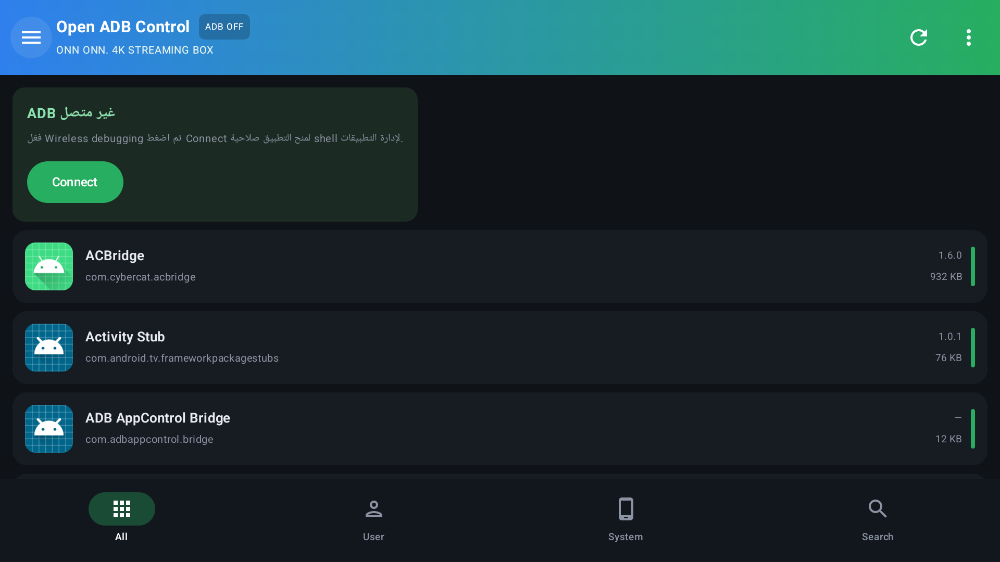
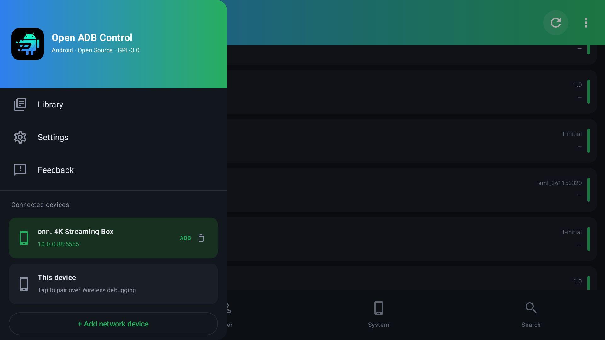

# ADB Control Android

تطبيق أندرويد **مفتوح المصدر** لإدارة تطبيقات الجهاز عبر **ADB ذاتي** (بدون كمبيوتر)،

> 🔗 **نسخة لينكس/ويندوز:** https://github.com/aelrased/adb-control-linux

> **الحالة:** MVP مبني ومُختبر على Android TV 14 (onn 4K). Android 10+ (API 29)،
> الاقتران الذاتي يتطلب Android 11+.



## الميزات

- قائمة التطبيقات مع الأيقونات والأسماء واسم الحزمة والإصدار وحجم APK.
- تصفية: الكل / مستخدم / نظام / معطّل + بحث فوري.
- إجراءات لكل تطبيق:
  - فتح التطبيق، معلومات التطبيق، حذف (واجهة النظام).
  - **تعطيل/تفعيل** و**مسح البيانات** عبر ADB shell.
  - **استخراج APK** إلى **Download/OpenADBControl** العام (عبر MediaStore، بدون صلاحيات تخزين)
    ويجمع الـ splits في ملف `.apks` واحد — يمكن الوصول إليه من أي مدير ملفات.
- **اقتران ADB لاسلكي** داخل التطبيق عبر mDNS + SPAKE2/TLS.
- **تعدد الأجهزة**: جهازك + أي عدد من أجهزة الشبكة (IP:5555 أو منفذ Wireless debugging)
  مع قائمة أجهزة قابلة للتبديل، حذف، وحفظ تلقائي.
- **تثبيت التطبيقات من البرنامج**: زر `Install APK` في القائمة، أو لمس أي ملف في Library.
  يدعم `.apk` و`.apks` (تثبيت متعدد الأجزاء)، ويستخدم `pm install -r` / `pm install-multiple`
  عند الاتصال بجهاز (محلي أو بعيد)، وإلا يفتح مثبّت النظام.
- **تحديد متعدد وإجراءات جماعية**: اضغط مطوّلاً على أي تطبيق، ثم:
  - تعطيل/تفعيل/حذف/مسح بيانات لكل المحدد دفعة واحدة (عبر ADB).
  - **نسخة احتياطية واحدة**: ZIP في `Download/OpenADBControl/backup-<time>.zip`
    يحتوي `<package>/base.apk` وملفات splits و`backup.json` (الاسم والإصدار).
  - تحديد الكل من شريط التحديد.
- **تكامل CleanYourTV**: شاشة تنظيف مدمجة مع 467 ملف تعريف من Gathin23/cleanyourtv،
  مطابقة تلقائية لموديل التلفزيون، وتعطيل/استعادة الحزم عبر ADB.
- **الجسر يعمل بلا واجهة**: Activity شفافة (Translucent) تُغلق نفسها، فلا تظهر شاشة سوداء.
- **أيقونات وأسماء وأحجام حقيقية للجهاز البعيد**: زر «تحميل الأيقونات» (أو
  `Sync remote data` من القائمة) يثبّت جسراً صغيراً (13 KB) على الجهاز البعيد عبر ADB،
  ثم يجلب الأيقونات و`apps.json` (بما فيه `sizeBytes` = مجموع Base + Splits) في أرشيف واحد.
- مظهر داكن مع تدرّج أخضر/أزرق، Drawer، وشريط سفلي.
- إعدادات: مراقبة التطبيقات (بيتا)، مجلد APK، منفذ TCP/IP، تحديثات بيتا.

## التقنية

| العنصر | الاختيار |
|---|---|
| اللغة/الواجهة | Kotlin 2.0 + Jetpack Compose (Material 3) |
| ADB | [Kadb](https://github.com/flyfishxu/Kadb) (Apache‑2.0) |
| صلاحيات بديلة | [Shizuku](https://shizuku.rikka.app/) (Apache‑2.0) |
| الاكتشاف | `kadb-mdns` عبر `NsdManager` |
| الأيقونات | `PackageManager` مباشرة |
| الحد الأدنى | Android 9 (API 28) |

### كيف يعمل الاقتران الذاتي؟

1. يفعّل المستخدم **Wireless debugging** ثم **Pair device with pairing code**.
2. يكتشف التطبيق منفذ الاقتران عبر mDNS (`_adb-tls-pairing._tcp`).
3. يُدخل المستخدم الرمز (6 أرقام) → SPAKE2 + TLS عبر Kadb → حفظ المفتاح في `filesDir/adbkey.pem`.
4. يتصل التطبيق بمنفذ `_adb-tls-connect._tcp` ويحصل على shell بمستخدم `shell`.
5. تُنفَّذ أوامر `pm disable-user` / `pm enable` / `pm clear` / `pm uninstall`.

### مصدر الصلاحيات: ADB أو Shizuku (أو كليهما)

- **ADB**: عبر اقتران Wireless debugging (يعمل دائماً، ويحتاج المنفذ).
- **Shizuku**: إن كان Shizuku مثبتاً ويعمل، يستخدم التطبيق صلاحياته تلقائياً عند عدم وجود اتصال ADB.
- **الأولوية**: ADB إن كان متصلاً، وإلا Shizuku. أوامر التعطيل/التفعيل/مسح الكاش/الحذف تعمل عبر الاثنين.
- من **Settings ← مصدر الصلاحيات** يمكن منح صلاحية Shizuku أو تثبيته، وتظهر حالة كل مصدر.
- الإجراءات التي تحتاج نقل ملفات (تثبيت APK، استخراج APK، النسخ الاحتياطي) تبقى بحاجة إلى ADB.

> الشكر لمشروع [Canta](https://github.com/samolego/Canta) (LGPL‑3.0) على إلهام فكرة الاعتماد على Shizuku للحذف/الاستعادة.

### إدخال بيانات الاقتران يدوياً

إذا لم يجد البحث التلقائي (mDNS) منفذ الاقتران:

1. من شاشة **Wireless debugging** اضغط **Pair device with pairing code**.
2. في التطبيق: **Connect over ADB** ← قسم **«إدخال يدوي»**:
   - `IP / host:pairing-port` (مثال `10.0.0.138:42765`)
   - `Pair port`
   - `Connect port` (من الشاشة الرئيسية أسفل مفتاح On، وليس منفذ الاقتران)
   - الرمز المكوّن من 6 أرقام
3. اضغط **Pair** — يقوم التطبيق بالاقتران ثم ينتظر منفذ Connect من mDNS ويتصل تلقائياً.
4. إذا تغيّر منفذ Connect: انسخه من شاشة Wireless debugging وضعه في **Connect port** ثم اضغط زر **Connect إلى host:port** (الزر يستخدم المنفذ اليدوي).

أو من **+ Add network device**: الحقول كلها ظاهرة (IP / Connect port / Pairing port / Code) والنافذة قابلة للتمرير.

### الاتصال الذاتي بالأجهزة القديمة (Android 9/10)

إذا كان `adbd` مفتوحاً على المنفذ `5555` (بعد `adb tcpip 5555` مرة واحدة من كمبيوتر،
أو عبر `persist.adb.tcp.port`)، فلا حاجة لأي كمبيوتر بعد ذلك:

1. **Connect over ADB** ← **«استخدام هذا الجهاز (IP الواي فاي تلقائياً)»**.
2. يكتشف التطبيق عنوان IP للواي فاي تلقائياً ويتصل بـ `<ip>:5555` (ويجرّب `127.0.0.1` كبديل).
3. تظهر نافذة **Allow USB debugging** على الشاشة ← اختر **Always allow** ثم **OK**.
4. يعيد التطبيق المحاولة تلقائياً حتى الموافقة ويصبح **ADB متصل** على الجهاز نفسه.

> إصلاح خاص: بعض أجهزة Android 9 (مثل Mi Box) تُرجع مفاتيح RSA بدون معاملات CRT من
> `KeyFactory`، ما كان يسبب الخطأ `Only RSA private keys with CRT parameters are supported`.
> يعالج التطبيق ذلك عبر مزوّد `KeyFactory` داخلي يعيد بناء المفتاح مع معاملات CRT.

> على Android 10 لا يوجد اقتران لاسلكي؛ يلزم `adb tcpip 5555` من كمبيوتر مرة واحدة
> (أو root). أما Android 11+ فيدعم الاقتران الكامل بدون كمبيوتر.

### إضافة جهاز آخر

من القائمة الجانبية: **+ Add network device**

| الحالة | ما تُدخله |
|---|---|
| ADB تقليدي (بعد `adb tcpip 5555` مرة واحدة من كمبيوتر) | IP الجهاز + المنفذ `5555` |
| نفس الجهاز (ADB ذاتي) | زر **«استخدام هذا الجهاز»** — يكتشف IP تلقائياً |
| Wireless debugging (Android 11+) | IP + **Pairing port** + **رمز 6 أرقام**، ثم **Connect port** الظاهر في شاشة Wireless debugging |

- يظهر على الجهاز البعيد تنبيه **Allow USB debugging** — اختر **Always allow**.
- تُحفظ الأجهزة المضافة، وتُعاد محاولة الاتصال عند اختيارها من القائمة.
- أيقونات/أسماء الأجهزة البعيدة تُجلب عبر زر **«تحميل الأيقونات»** (تثبيت جسر مرة واحدة).

### الحذف والاستعادة

- **Uninstall (عادي)**: `pm uninstall --user 0` — قابل للاستعادة.
- **استعادة (Install existing)**: `pm install-existing --user 0` من قائمة إجراءات التطبيق أو من شاشة **«المحذوفة (استعادة)»** في الدرج.
- **حذف نهائي (نسخة المصنع)**: يزيل تحديثات النظام ثم يحذف للمستخدم 0، مع **رسالة تحذير حمراء** قبل التنفيذ. إزالة نسخة /system نهائياً تتطلب روت أو علم `DELETE_SYSTEM_APP` المميز.
- تصنيف **UDADB‑NG** مضمّن: يظهر في قائمة الإجراءات (موصى به / متقدم / خبير / غير آمن).

### المكتبة (Library) — مكان التثبيت الوحيد

- زر **«تثبيت APK / .apks لهذا الجهاز»** داخل Library.
- أي ملف APK مستخرج أو محفوظ في `Download/OpenADBControl` يظهر في المكتبة، والضغط عليه يثبّته.
- لا يوجد زر تثبيت منفصل في الدرج — مكان واحد فقط لتجنّب الالتباس.

### تبويب User

`User` = التطبيقات الخارجية المثبّتة (`pm list packages -3`)، و`System` = تطبيقات النظام.
على جهاز onn المذكور: 40 تطبيق مستخدم مقابل 128 نظامياً — وهو السلوك الصحيح.



## البناء

```bash
# نسخة الإصدار (مصغّرة R8، ~12MB)
./gradlew :app:assembleRelease
```

> ملاحظة: APK الإصدار يوقّع بمفتاح debug نفسه المستخدم في الإصدارات السابقة، حتى تُثبّت التحديثات فوق النسخة الموجودة دون فقدان البيانات.

## البناء

```bash
export ANDROID_HOME=$HOME/Android/Sdk
./gradlew :app:assembleDebug
# APK: app/build/outputs/apk/debug/app-debug.apk
```

محلياً استُخدم Gradle 8.13 + AGP 8.7.3 + JDK 17/21.

## البنية

```
app/src/main/java/dev/oss/adbcontrol/
├── App.kt              # تهيئة هوية ADB (KadbCert)
├── AdbManager.kt       # الاكتشاف، الاقتران، الاتصال، تنفيذ shell
├── AppViewModel.kt     # الحالة + الإجراءات + استخراج APK
├── AppsRepository.kt   # قراءة التطبيقات والأيقونات من PackageManager
├── Data.kt             # النماذج
├── Theme.kt            # ألوان Material3
└── MainActivity.kt     # كل شاشات Compose
```

## خريطة الطريق

- [ ] إشعار اقتران مع RemoteInput (إدخال الرمز دون مغادرة شاشة النظام).
- [ ] مراقبة التثبيت/التحديث في الخلفية (ForegroundService).
- [ ] اقتران تلقائي بعد إعادة تشغيل Wireless debugging.
- [ ] دعم Android 10 عبر `adb tcpip`.
- [ ] Library: تثبيت/مشاركة ملفات `.apk` و`.apks`.
- [ ] نسخ احتياطي واستعادة، وصلاحيات التطبيقات.
- [ ] ترجمة عربية كاملة + ثيمات.

## الترخيص

GPL‑3.0‑or‑later. Kadb بترخيص Apache‑2.0. Android علامة تجارية لـ Google؛
هذا المشروع غير مرتبط بـ Google أو CyberCat.
